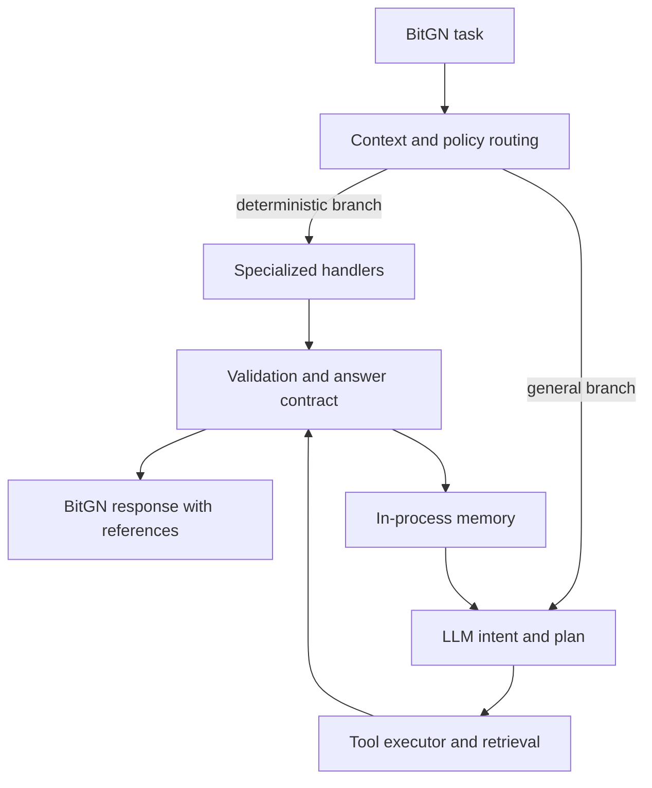

# BitGN ECOM1 — агент для задач электронной коммерции

[English](README_EN.md) · [Обзор](docs/PROJECT_OVERVIEW_RU.md) · [Архитектура](docs/ARCHITECTURE_RU.md)

ECOM1 — Python-агент для выполнения задач в инструментальной тестовой среде BitGN: поиск товаров и остатков, интерпретация запросов, проверка ограничений и формирование ответов со ссылками на источники. Он сочетает LLM-планирование с детерминированными обработчиками и проверками. **Публичный репозиторий является портфолио/демонстрационной версией. Основной исходный код проекта пока не опубликован.**

## Проект в цифрах

| Показатель | Проверено по переданному снимку |
|---|---:|
| Файлы актуального Python-кода (по правилам отбора) | 34 |
| Строки актуального Python-кода | 6828 |
| Файлы тестового кода | 2 |
| Строки тестового кода | 118 |
| Автоматические тесты | Успешный прогон не подтверждён |
| Техническая документация в снимке | 1 Markdown-файл, 8 строк |

Подсчёт исключает исторические копии, сгенерированный protobuf, резервные варианты модулей и инфраструктурные файлы. Показатели относятся к отобранным актуальным файлам предоставленного снимка; успешный запуск тестового набора не подтверждён.

## Задача продукта

Выполнять разнотипные запросы к каталогу, остаткам и операциям электронной коммерции, сохраняя структурированный результат и обоснованные ссылки на найденные записи. Важная часть задачи — не смешивать допустимые информационные запросы с запрещёнными или неподдерживаемыми действиями.

## Ключевые возможности

- Извлечение намерения из естественного языка и планирование шагов.
- SQL-поиск, сопоставление атрибутов, оценка кандидатов и обработка остатков.
- Правила маршрутизации запросов, включая ограничения на отдельные операции.
- Проверка структуры ответа и ссылок; дополнительные семантические проверки.
- Краткосрочный контекст в памяти процесса; отдельная ветка анализа архивных платёжных записей.

## AI/LLM-составляющая и собственная инженерная работа

В конфигурации предусмотрены три роли: **Claude Sonnet 4.6** (оркестрация), **Gemini 2.5 Flash** (подготовка отдельных инструментальных шагов), **GPT-4.1** (проверка). Вызовы реализованы через HTTP-клиент с OpenAI-совместимым форматом. Это конфигурация кода, а не подтверждение доступности моделей в настоящий момент.

Собственная логика проекта включает pipeline, обработчики сценариев, Retrieval Engine, policy routing, разрешение контекстных ссылок, answer contract, обработку ошибок и эпизодическую память. Детерминированные ветки могут формировать ответы без LLM.

## Состояние компонентов

| Component | Status |
|---|---|
| CLI и интеграция с BitGN harness/VM | Implemented (в коде; внешний запуск не проверен) |
| LLM orchestration / tool execution | Implemented (в коде) |
| Retrieval / scoring / inventory handlers | Implemented (в коде) |
| Policy routing / answer contract | Implemented (в коде) |
| Validation / repair logic | Implemented (в коде; полнота проверки не доказана) |
| In-process memory | Implemented (в коде) |
| Fraud investigation branch | Implemented (специализированный сценарий) |
| Универсальный Candidate Selection Layer | Planned (TODO в коде) |
| Исторические датированные каталоги и файлы с суффиксами `-.py` | Legacy |
| Надёжная автоматическая регрессия | In development / не подтверждена |

## Архитектура

Схема отражает реализованные маршруты на уровне исходного кода; успешное end-to-end выполнение не подтверждено. Подробнее: [архитектура](docs/ARCHITECTURE_RU.md).

## Технологии

Python 3.11+, httpx, python-dotenv, protobuf, connectrpc, requests, rapidfuzz; интеграция с инструментами BitGN и внешним LLM API. SQL используется через инструменты среды, собственная рабочая СУБД в снимке не обнаружена.

## Roadmap

Унификация выбора кандидатов и воспроизводимые регрессионные тесты — направления дальнейшей работы; они **не заявляются реализованными**.

## Содержимое публичного репозитория

Публикуется техническое описание, без рабочего кода, истории Git, данных среды, логов, ключей и конфигурации доступа. Описание не является инструкцией для развёртывания закрытой тестовой среды.

## Правовой статус

Лицензия не предоставлена; файл `LICENSE` отсутствует. Публикация документации не означает предоставления прав на закрытый исходный код или материалы третьих лиц.

Проект разработан независимо для соревнования BitGN ECOM1. Он не является официальным продуктом BitGN, не поддерживается организатором и не подразумевает его одобрения. Название BitGN используется исключительно для идентификации соревнования.
