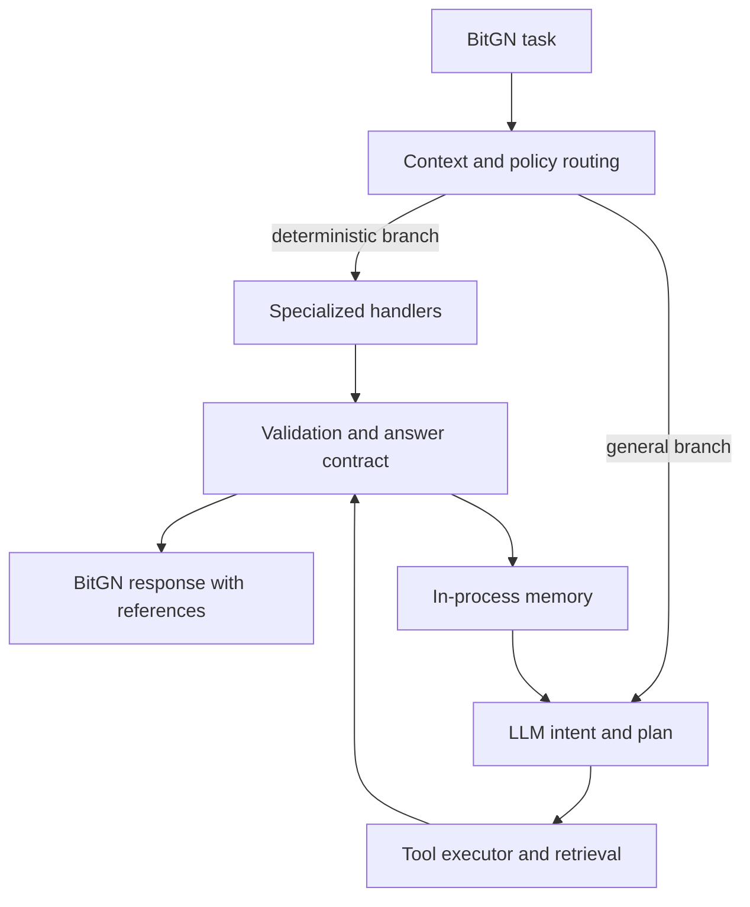

# BitGN ECOM1 — an e-commerce task agent

[Русский](README.md) · [Overview](docs/PROJECT_OVERVIEW_EN.md) · [Architecture](docs/ARCHITECTURE_EN.md)

ECOM1 is a Python agent built for the BitGN instrumented e-commerce benchmark. It handles product and inventory queries, request interpretation, policy decisions, and evidence-backed responses. The implementation combines LLM planning with deterministic handlers and checks. **This public repository is a portfolio/documentation edition. The main project source code has not been published.**

## Project at a glance

| Metric | Verified from the supplied snapshot |
|---|---:|
| Current Python source files (defined selection rules) | 34 |
| Current Python source lines | 6828 |
| Test source files | 2 |
| Test source lines | 118 |
| Automated tests | No successful suite run verified |
| Technical documentation in snapshot | 1 Markdown file, 8 lines |

The count excludes dated copies, generated protobuf code, backup variants, and infrastructure artifacts. A successful automated test-suite run has not been verified.

## Problem

Answer heterogeneous e-commerce requests against catalog, stock, and operational records while preserving structured outcomes and references to retrieved evidence. The agent must distinguish supported informational tasks from disallowed or unsupported operations.

## Capabilities

- Natural-language intent extraction and multi-step planning.
- SQL-based retrieval, attribute matching, candidate scoring, and inventory handling.
- Deterministic policy routing for selected operational scenarios.
- Output and reference validation, with optional semantic review.
- Short-lived in-process memory and a specialized archived-payment investigation path.

## AI/LLM and engineering contributions

The configuration assigns **Claude Sonnet 4.6** to orchestration, **Gemini 2.5 Flash** to selected execution steps, and **GPT-4.1** to validation. Calls use an OpenAI-compatible HTTP interface. These are code-configured roles, not a claim that the providers are currently available.

The team's application logic covers orchestration, specialized handlers, a retrieval engine, policy decisions, contextual reference resolution, answer contracts, error handling, and episodic memory. Some requests are handled by deterministic branches without LLM calls.

## Component status

| Component | Status |
|---|---|
| CLI and BitGN harness/VM integration | Implemented in code; external execution unverified |
| LLM orchestration and tool execution | Implemented in code |
| Retrieval, scoring, inventory handlers | Implemented in code |
| Policy routing and answer contract | Implemented in code |
| Validation and repair | Implemented in code; effectiveness unverified |
| In-process memory | Implemented in code |
| Fraud investigation branch | Implemented for a specialized scenario |
| Universal Candidate Selection Layer | Planned (source TODO) |
| Dated directories and hyphen-suffixed module copies | Legacy |
| Reliable automated regression suite | In development / unverified |

## Architecture

The diagram represents code-level paths, not a verified end-to-end deployment. See [architecture](docs/ARCHITECTURE_EN.md).

## Technology

Python 3.11+, httpx, python-dotenv, protobuf, connectrpc, requests, rapidfuzz, BitGN tool integration, and an external LLM API. SQL runs through environment tools; no dedicated operational database is included in this snapshot.

## Roadmap

Candidate selection consolidation and reproducible regression testing are future improvements, **not completed capabilities**.

## Public repository scope

Only technical documentation is published. Working source, Git history, benchmark data, runtime logs, access credentials, and infrastructure details are withheld.

## Legal status

No license is granted and no `LICENSE` file is included. Publishing this documentation does not grant rights to the private source code or third-party materials.

**Independent project.** This project was independently developed for the BitGN ECOM1 agent challenge. It is not affiliated with, endorsed by, or maintained by BitGN. The BitGN name is used solely to identify the competition.
