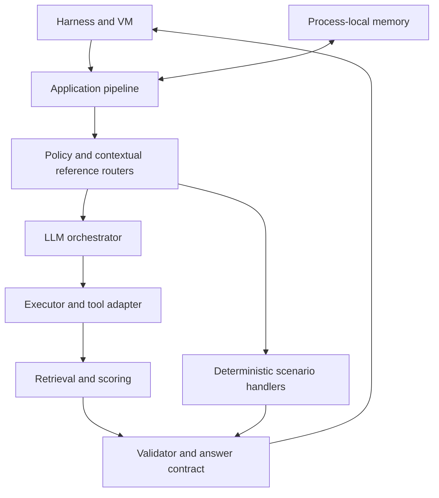

# ECOM1 architecture

[Русский](ARCHITECTURE_RU.md) · [Home](../README_EN.md)

## Principles

`main.py` initializes BitGN harness/VM clients, process-local memory, and a tool adapter before invoking `agent.pipeline.run_pipeline`. Connectors use protobuf/connectrpc. The LLM does not directly invoke the environment: execution flows through `agent.executor` and the supplied `tool_caller`. This is a code-level separation, not a formal security guarantee.

## Components and implementation status

| Component | Observed status |
|---|---|
| `main.py`, `bitgn/`, `tool_utils.py` | CLI and connectors implemented; external execution unverified |
| `agent/orchestrator.py`, `agent/llm_client.py` | Model calls, prompts, and plan parsing implemented |
| `agent/executor.py` | Tool execution and basic SQL checks; not a comprehensive SQL sandbox |
| `retrieval/engine.py`, `retrieval/intent.py` | Retrieval, attribute matching, and scoring implemented |
| `agent/policy_router.py`, `agent/policy_action_router.py` | Selected policy and action routes implemented |
| `agent/answer_contract.py`, `agent/validator.py` | Reference/format and optional LLM checks; some errors permit permissive fallback |
| `memory/store.py` | Stable context and bounded in-RAM episodic memory implemented |
| `agent/fraud_investigation.py` | Specialized read-only investigation path implemented |
| Universal candidate selection | Planned in source TODO; not a completed layer |

## Data flow

The harness provides a task → contextual references are resolved → specialized policy/action routes are evaluated → if required, an LLM extracts an intent → the executor invokes tools → retrieval produces candidates and match evidence → validation and answer contract produce outcome/message/grounding_refs → the response is returned to the harness.

## Persistence, failure modes, and verification

SQL runs through VM tools, not an embedded operational database service. Memory is not durable. Bounded repair and exception fallbacks exist, but do not prove universal fail-closed behavior. The supplied snapshot does not include a passing automated regression suite. This public description omits private identifiers, infrastructure addresses, and access configuration.
