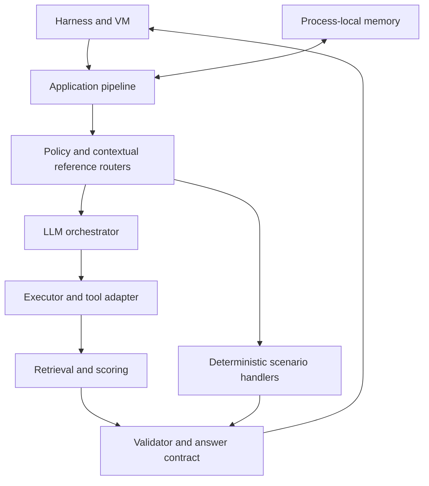

# Архитектура ECOM1

[English](ARCHITECTURE_EN.md) · [Главная](../README.md)

## Принципы

В `main.py` создаются клиенты BitGN harness/VM, память и инструментальный адаптер; затем вызывается `agent.pipeline.run_pipeline`. Коннекторы используют protobuf/connectrpc. Модель не обращается к среде напрямую: шаги проходят через `agent.executor` и переданный `tool_caller`. Это разграничение на уровне кода, не формальная гарантия безопасности.

## Компоненты и статус

| Компонент | Фактическое состояние |
|---|---|
| `main.py`, `bitgn/`, `tool_utils.py` | Реализованы коннекторы и CLI; внешняя работоспособность не проверена |
| `agent/orchestrator.py`, `agent/llm_client.py` | Реализованы промпты, разбор планов и вызовы моделей |
| `agent/executor.py` | Реализованы tool calling и базовая проверка SQL; не универсальная SQL-песочница |
| `retrieval/engine.py`, `retrieval/intent.py` | Реализованы поиск, сопоставление и скоринг |
| `agent/policy_router.py`, `agent/policy_action_router.py` | Реализована маршрутизация отдельных политик и операций |
| `agent/answer_contract.py`, `agent/validator.py` | Реализованы проверки ссылок/формата и опциональная LLM-проверка; отдельные ошибки могут завершаться permissive fallback |
| `memory/store.py` | Реализована стабильная конфигурация и ограниченная эпизодическая память в RAM |
| `agent/fraud_investigation.py` | Реализована узкоспециализированная read-only ветка |
| Универсальный выбор кандидатов | Запланирован (TODO), не реализован как отдельный слой |

## Движение данных

Задание поступает из harness → извлекаются контекстные ссылки → проверяются специальные policy/action-маршруты → при необходимости LLM извлекает intent → исполнитель запрашивает инструменты → retrieval формирует кандидатов и признаки соответствия → проверка и контракт ответа формируют outcome/message/grounding_refs → результат возвращается в harness.

## Данные, ошибки, проверки

SQL исполняется через инструмент VM, а не через собственный сервер БД. Память не является долговременным хранилищем. Есть ограниченные попытки исправления и fallback-ответ при исключениях; это не доказывает fail-closed для всех веток. В снимке отсутствует надёжный проходящий автоматический набор тестов. Публикуемая схема намеренно не содержит конфиденциальных путей, идентификаторов, сетевых адресов или схем доступа.
